# MyWay — livraison de quartier (MVP Gagnoa)

Plateforme qui relie les petits commerces de quartier (boutiques, maquis, pharmacies, quincailleries, vendeuses de marché) à leurs clients, avec des livreurs indépendants. Premier lancement : **Gagnoa** (quartiers Commerce, Dioulabougou, Garahio, Babré), puis les autres villes de Côte d'Ivoire.

Le périmètre et les choix techniques suivent le cahier des charges du projet (sections 3 « Périmètre fonctionnel » et 5 « Architecture technique »).

## Contenu du dépôt (monorepo)

| Dossier | Rôle | Techno | État |
|---|---|---|---|
| [`apps/api`](apps/api) | API unique pour toutes les interfaces | NestJS, PostgreSQL + PostGIS, Socket.IO | ✅ étape 1 |
| [`apps/client`](apps/client) | Application client (Android, puis iOS) | Flutter | ✅ étape 1 |
| [`apps/merchant`](apps/merchant) | Application commerçant (+ mode agent terrain) | Flutter | ✅ étape 2 |
| [`apps/courier`](apps/courier) | Application livreur | Flutter | ✅ étape 3 |
| [`apps/admin`](apps/admin) | Console d'administration web | Next.js | ✅ étape 4 |
| [`packages/app_core`](packages/app_core) | Code partagé des apps Flutter (API, modèles, thème, connexion) | Dart | ✅ |

Les cinq interfaces sont en place. L'étape suivante branche les vrais services (SMS, Mobile Money, appels masqués, hébergement).

Voir la [feuille de route](docs/feuille-de-route.md) pour le découpage complet.

## Démarrage rapide

Prérequis : Node.js 22, Docker (ou PostgreSQL 16 + PostGIS), Flutter stable.

```bash
# 1. Base de données
docker compose up -d db

# 2. API
cd apps/api
cp .env.example .env
npm install
npm run migration:run       # crée les tables
npm run seed                # Gagnoa, quartiers, tarifs, commissions + données de démo
npm run start:dev           # http://localhost:3000/api  —  documentation : http://localhost:3000/api/docs

# 3. Application client (émulateur Android : l'API est jointe via 10.0.2.2)
cd ../client
flutter pub get
flutter run --dart-define=API_URL=http://10.0.2.2:3000

# 4. Console d'administration (http://localhost:3001, compte 07 00 00 00 00)
cd ../admin
npm install
npm run dev
```

### Comptes de démonstration (créés par `npm run seed`)

En développement, le code SMS s'affiche dans l'application et dans les logs de l'API (aucun SMS n'est envoyé).

| Rôle | Téléphone |
|---|---|
| Administrateur | 07 00 00 00 00 |
| Client (avec une adresse) | 07 06 06 06 06 |
| Commerçante « Boutique Chez Awa » | 07 01 01 01 01 |
| Commerçant « Maquis Le Bon Garba » | 05 02 02 02 02 |
| Livreurs | 07 04 04 04 04, 05 05 05 05 05 |
| Agent terrain | 07 07 07 07 07 |

Les coordonnées GPS des quartiers et des repères sont **approximatives** : à remplacer par les relevés des agents terrain.

## Tests

```bash
cd apps/api && npm test && npm run test:e2e   # la base livraison_test est créée par docker compose
cd apps/client && flutter analyze && flutter test
cd apps/merchant && flutter analyze && flutter test
cd apps/courier && flutter analyze && flutter test
cd apps/admin && npm test && npm run build
```

Le test de bout en bout `apps/api/test/order-flow.e2e-spec.ts` déroule la boucle complète du MVP : commande, alerte temps réel au commerçant, affectation au livreur le plus proche, passage au suivant après 30 s, code de remise, encaissement, commissions, plafond d'espèces, Mobile Money, remplacement de produit, annulation, inscription assistée, tableaux de bord.

## Aperçu de l'application client

| Quartier | Commerces | Catalogue | Panier | Suivi | Livrée |
|---|---|---|---|---|---|
|  | 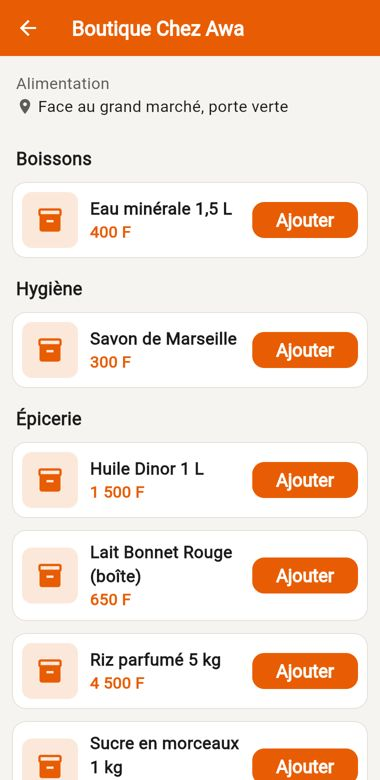 | 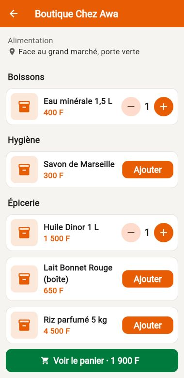 | 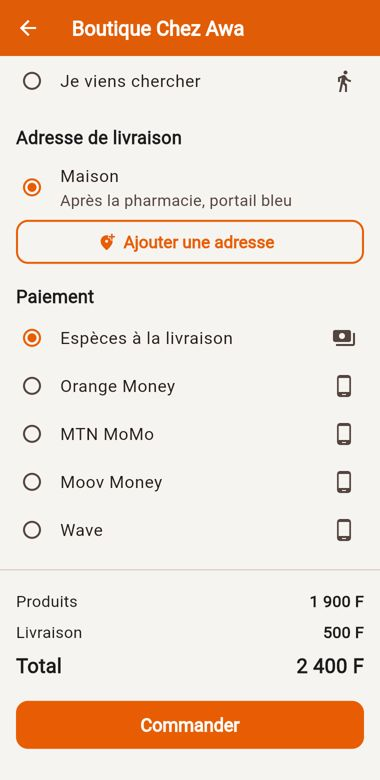 | 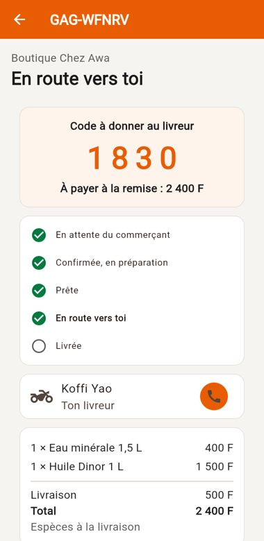 |  |

## Aperçu de l'application commerçant

| Nouvelle commande | Détail | Je livre moi-même | Remise par code | Catalogue | Mes ventes |
|---|---|---|---|---|---|
| 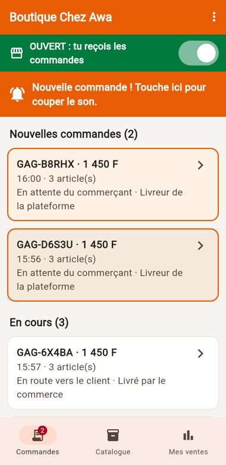 | 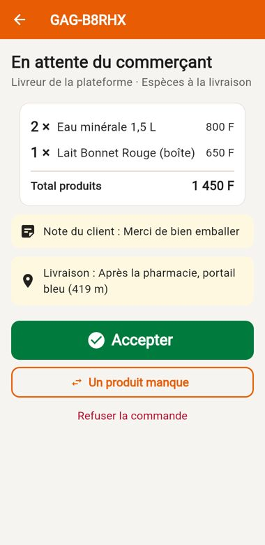 | 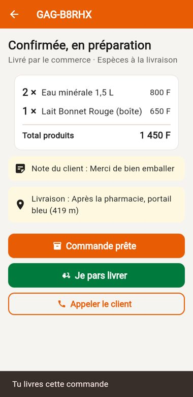 | 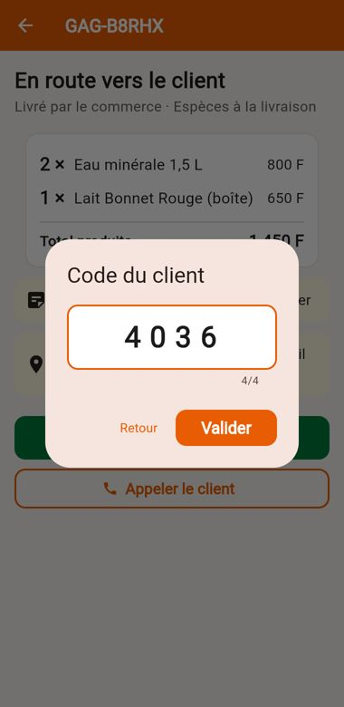 | 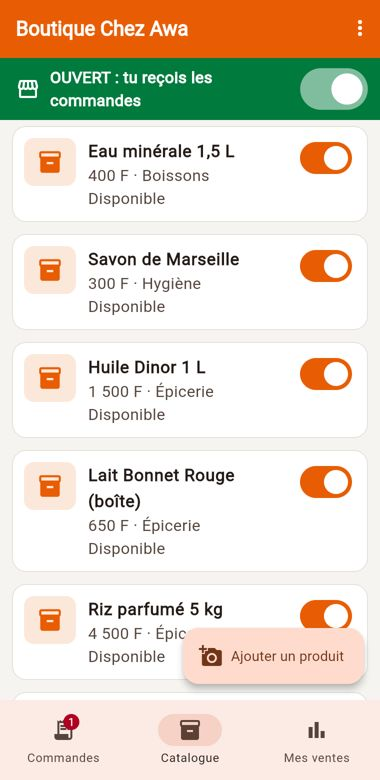 | 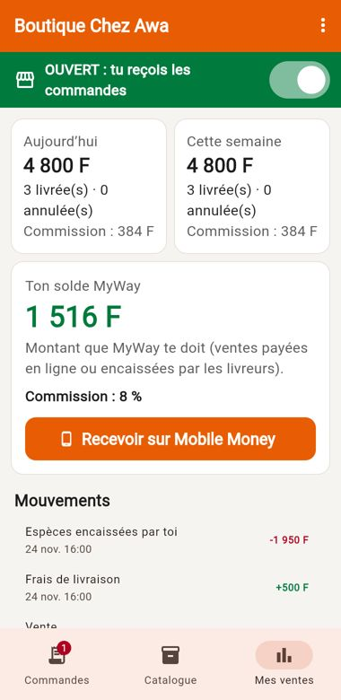 |

## Aperçu de l'application livreur

| Proposition de course | Aller au commerce | En route | Remise par code | Course terminée | Gains |
|---|---|---|---|---|---|
| 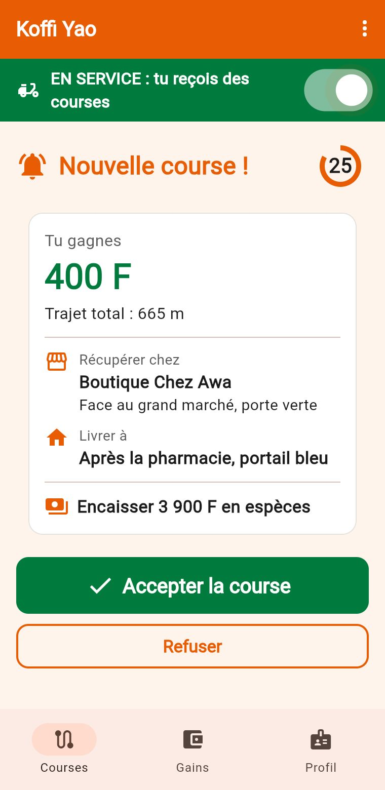 | 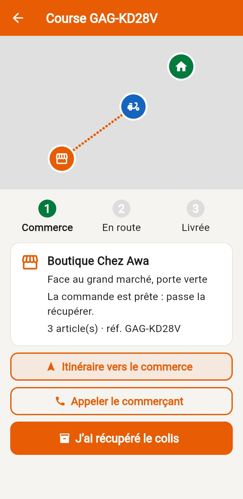 | 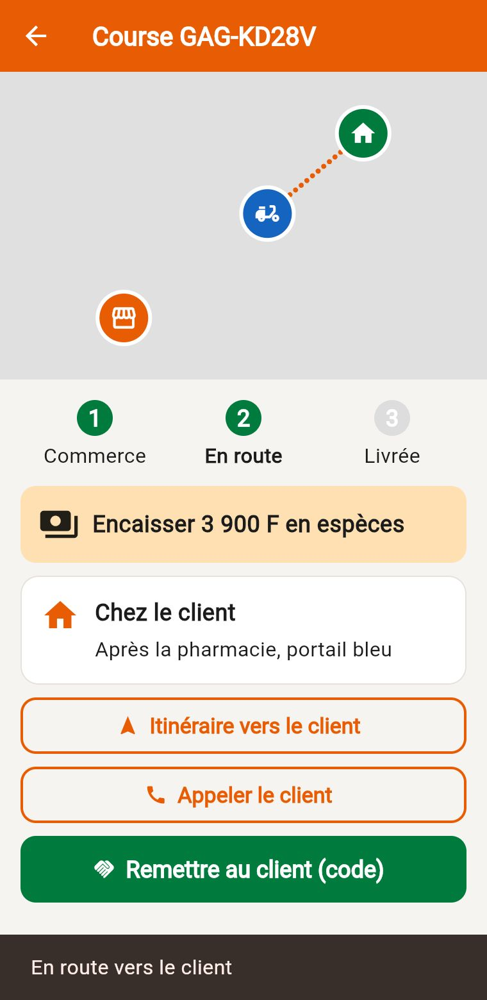 | 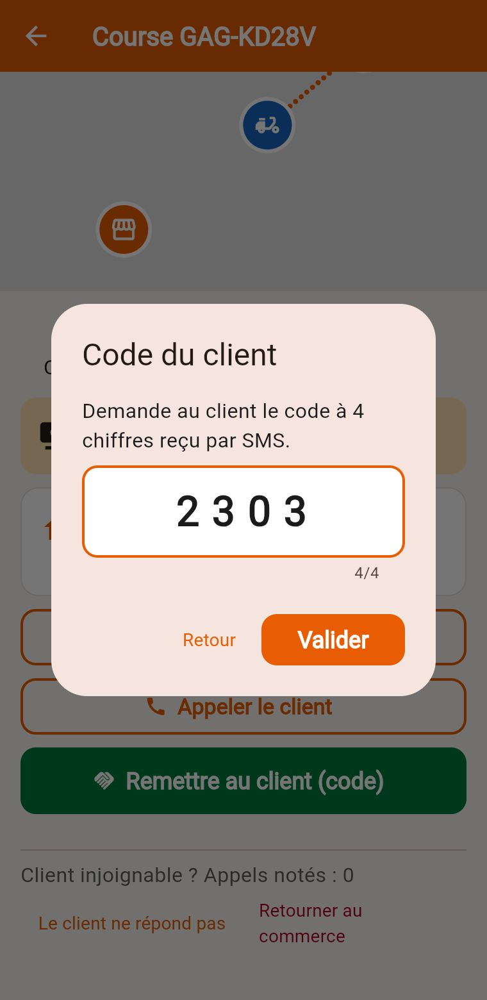 | 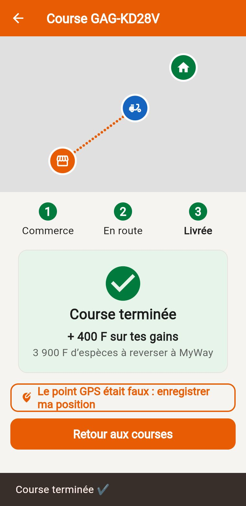 | 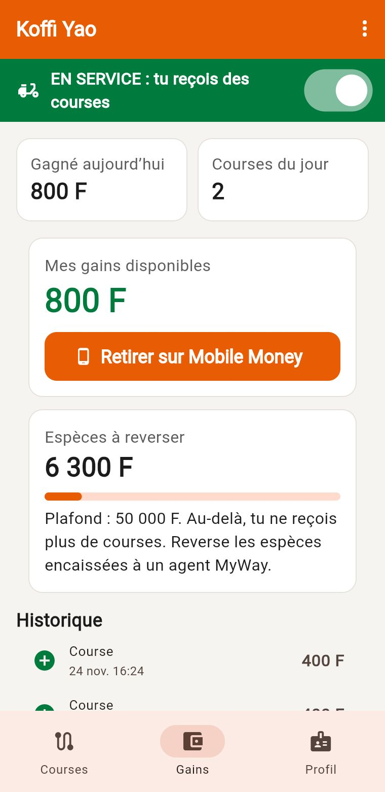 |

## Aperçu de la console d'administration

| Tableau de bord | Carte en direct | Commande et réaffectation |
|---|---|---|
| 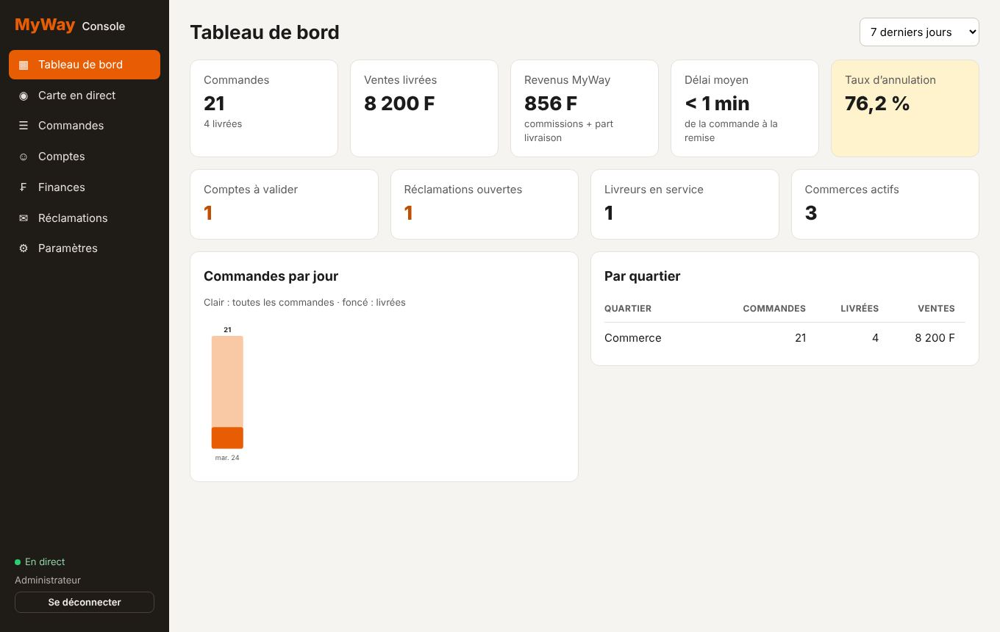 | 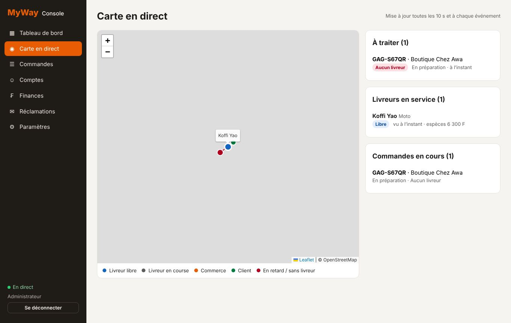 | 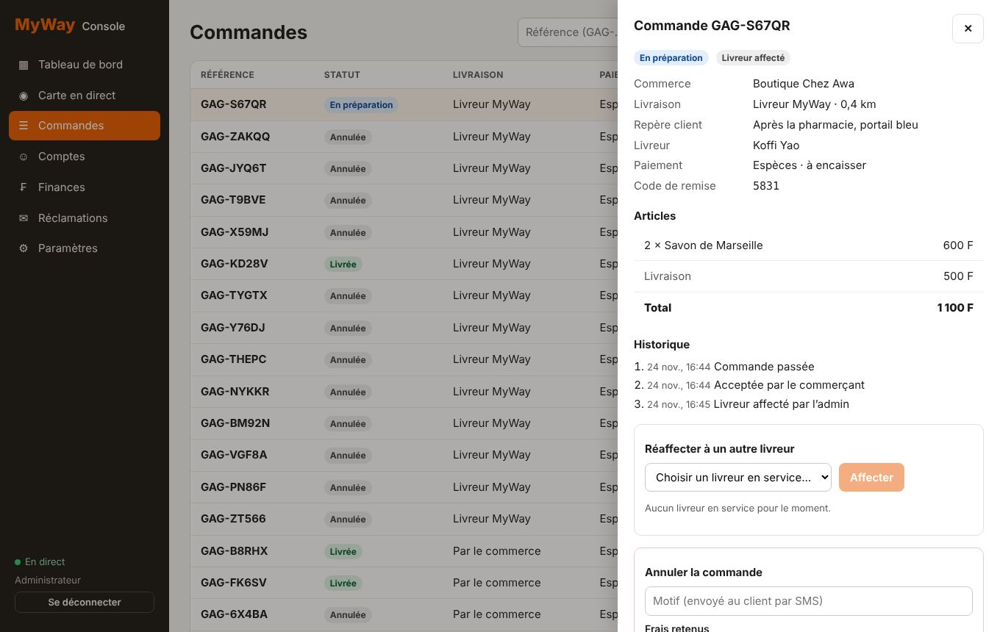 |
| **Comptes à valider** | **Espèces des livreurs** | **Réclamation et remboursement** |
| 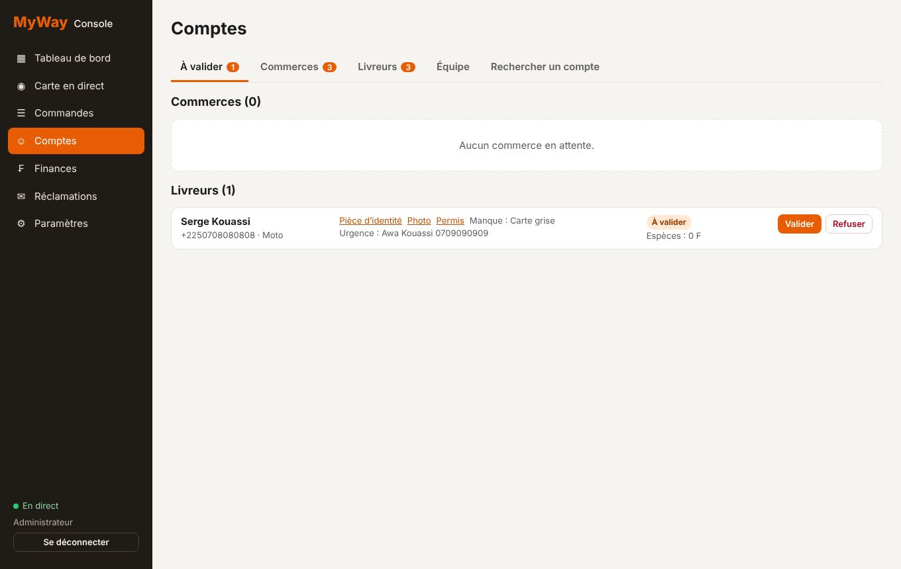 | 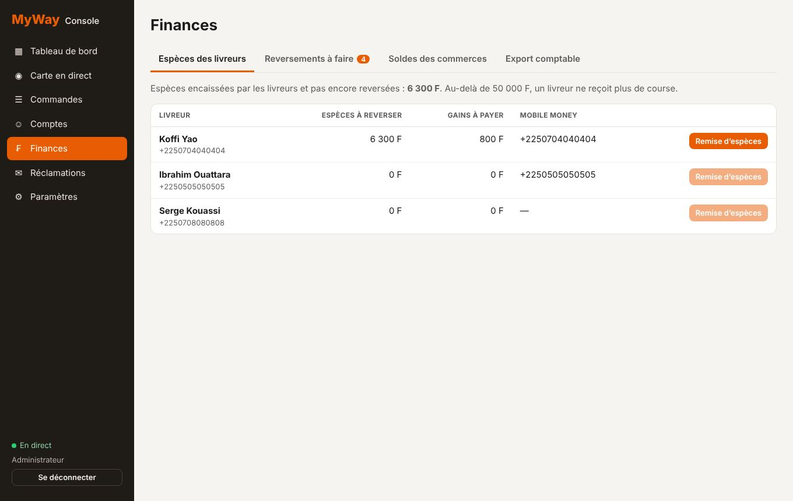 | 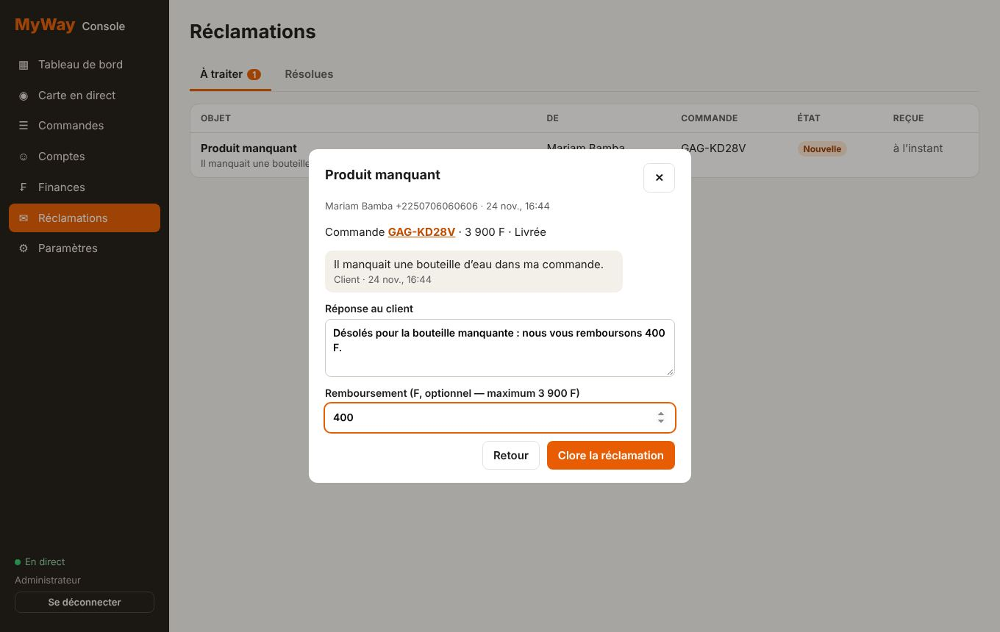 |
